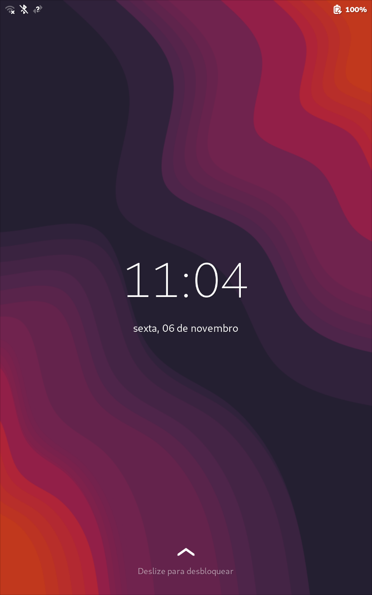
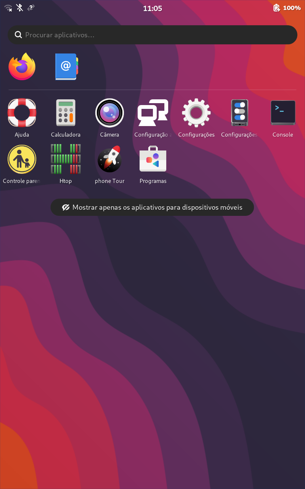
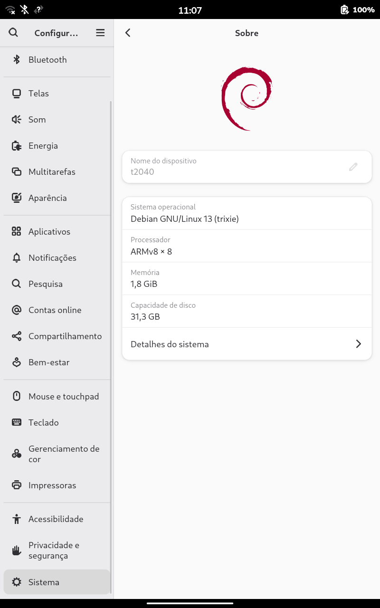
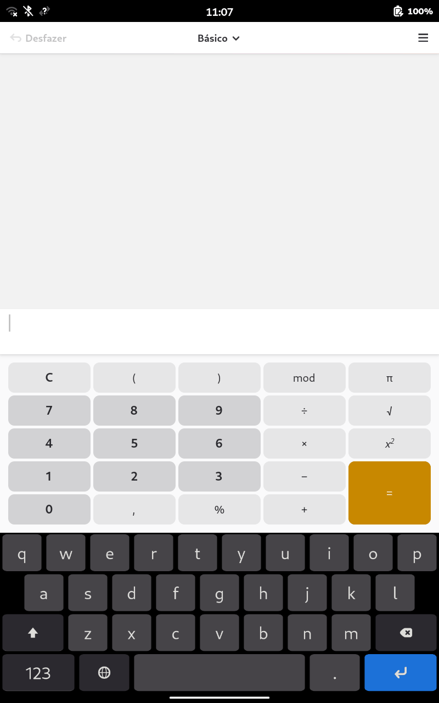
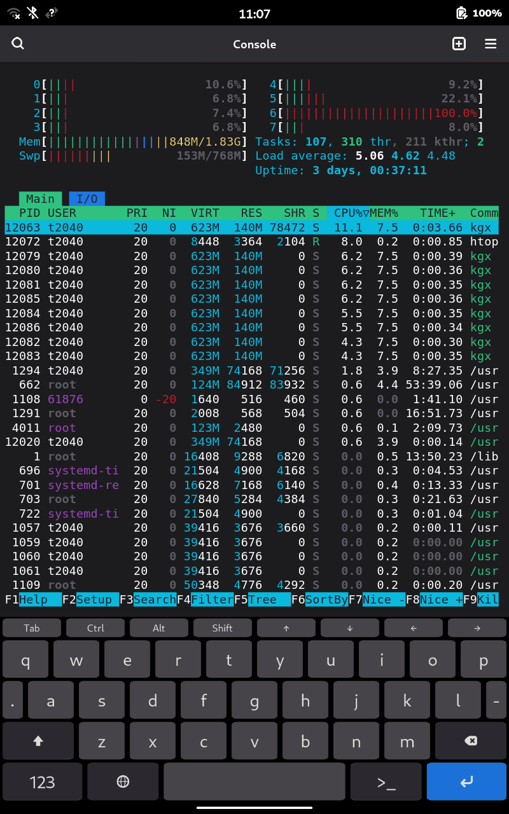
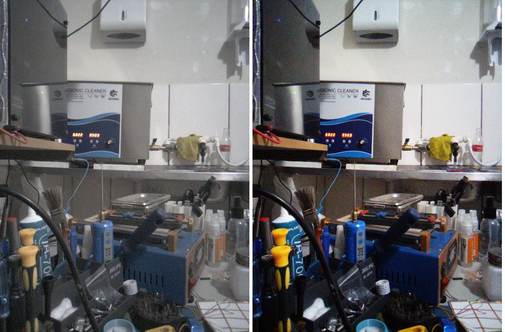
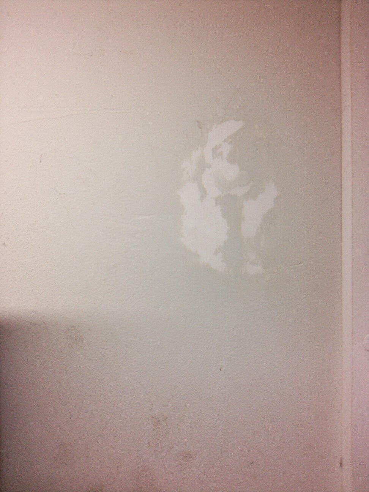

# Debian 13 + Phosh no Positivo T2040 (não oficial)

Port **não oficial e experimental** do Debian 13 (trixie, armhf) com a interface Phosh para o tablet
**Positivo T2040 / M10 4G PRO X** (Unisoc SC9863A / S863T, placa 9863A V1.0 210119 L1).

O kernel é um Linux 4.14.193 compilado a partir da fonte aberta do Realme C21Y (mesmo BSP Unisoc) com
um patch próprio. Ele é compatível com os módulos originais do tablet (Wi-Fi, GPU, toque, câmeras).

> **Atenção:** a instalação **apaga todos os dados** do tablet e desbloqueia o bootloader.
> Use por sua conta e risco. O Android continua no slot A como reserva.

## Estado (v0.2)

| Recurso | Situação |
|---|---|
| Tela, toque, Phosh com GPU PowerVR | funciona |
| Wi-Fi, rede e SSH pela USB | funciona |
| Bluetooth, inclusive fone e caixa de som (A2DP) | funciona; o áudio passa sozinho para o aparelho conectado |
| Áudio (alto-falante, fone e microfone), câmeras traseira e frontal | funciona |
| Bateria carregando, acelerômetro, giroscópio e rotação da tela | funciona |
| Suspensão | funciona: na bateria, dorme após 15 min sem uso e acorda pelo botão; na tomada ou com o cabo USB de dados ligado ao PC, não dorme |
| OTG (pendrive, disco) | funciona; ligue o adaptador com o tablet já ligado |
| GPS | experimental: o NMEA chega e vai para o GeoClue, mas a posição com céu aberto ainda não foi testada |
| Rádio FM | não funciona: o sintonizador responde, mas ainda não há áudio nem app |
| Modem 4G (chamadas, SMS, dados móveis) | não funciona |
| Sensor de luz e de proximidade, vibração, LED de notificação, leitor de digital | o tablet não tem |

A suspensão pode ser desligada com `sudo t2040-suspensao off` (e religada com `on`).
Para usar o GPS, ligue a localização em **Configurações > Privacidade > Localização**.

## Imagens

Capturas de tela tiradas no próprio tablet (800×1280, com `grim`):

| Tela de bloqueio | Aplicativos | Configurações > Sobre |
|---|---|---|
|  |  |  |

| Calculadora com o teclado na tela | Console com o htop |
|---|---|
|  |  |

Fotos das câmeras, tiradas no Debian:



*Câmera traseira (GC5035): à esquerda, sem a correção de cor; à direita, com a matriz de cor e a curva gama
do fabricante.*



*Foto tirada pela câmera do tablet no Debian.*

## Instalar

### Requisitos

- PC com **Windows 10 ou 11** e um **cabo USB de dados**.
- Tablet com **mais de 50% de bateria**.
- **Python 3.8 ou mais novo**: <https://www.python.org/downloads/windows/>.
  Na instalação, marque **"Add python.exe to PATH"**.
- **Driver USB** do tablet. Use um dos dois:
  - **Driver Unisoc/Spreadtrum** (recomendado). Ele cobre o adb do Android (`18D1:4EE8`), o fastboot
    (`18D1:4EE0`) e o modo BROM de recuperação (`1782:4D00`):
    <https://www.hovatek.com/forum/thread-16832.html> (pacote `SPD_Driver_R4.20.4201`, instalação automática).
  - **Google USB Driver**, que cobre só o fastboot:
    <https://developer.android.com/studio/run/win-usb>
    ([zip direto](https://dl.google.com/android/repository/usb_driver_r13-windows.zip)).
- **Rede USB (RNDIS):** não precisa de driver. O Windows reconhece o tablet sozinho como
  "Dispositivo compatível com NDIS remoto".

O `instalar.cmd` baixa sozinho o resto:

| Item | Origem |
|---|---|
| adb e fastboot (Android SDK Platform-Tools) | <https://developer.android.com/tools/releases/platform-tools> |
| unisoc-unlock (desbloqueio do bootloader) | <https://github.com/patrislav1/unisoc-unlock> |
| Boot do Linux e sistema Debian | [release v0.2-experimental](https://github.com/faelhs/Unofficial-Linux-Debian-Mobile-Port-Positivo-T2040-Unisoc-SC9863A-S863T-9863A-V1.0-210119-L1.-/releases/tag/v0.2-experimental) |

### Passo a passo

1. No Android, ative as opções do desenvolvedor: **Configurações > Sobre o tablet** e toque 7 vezes em
   **Número da versão**.
2. Em **Configurações > Sistema > Opções do desenvolvedor**, ligue a **Depuração USB**.
   Se existir a opção **Desbloqueio de OEM**, ligue também.
3. Conecte o cabo e aceite a pergunta **"Permitir depuração USB?"** na tela do tablet.
4. No PC, dê dois cliques em **`instalar.cmd`** e digite `SIM` quando ele pedir.
5. Quando o script disser, **confirme o desbloqueio na tela do tablet** com as teclas de volume.
6. Espere. O tablet reinicia, mostra o log do Linux e entra no **MODO INSTALAÇÃO**.
   O PC envia o sistema (cerca de 860 MB), e o tablet grava, confere e reinicia no Debian.
7. Entre com o usuário **`t2040`** e o PIN **`1234`**. Troque a senha em **Configurações > Usuários**.

O primeiro boot leva uns 2 minutos, porque o sistema de arquivos cresce para ocupar o armazenamento inteiro.

### Como a instalação funciona

- O boot do Linux vai para a partição `boot_b` e o slot B fica ativo. O slot A continua com o Android.
- O AVB do tablet aceita o boot porque ele é assinado com a chave de referência pública da Unisoc,
  que a Positivo nunca trocou. Não há exploit nem desativação de verificação.
- O Debian fica na partição `userdata`, em ext4.
- **Proteções automáticas:**
  - com 3 boots seguidos sem o Debian confirmar a subida, o tablet para no sistema mínimo (modo instalação);
  - com 7 falhas seguidas do slot B, o bootloader volta sozinho ao slot A.

### Reinstalar ou voltar ao Android

- **Reinstalar o Debian ou passar da v0.1 para a v0.2:** no tablet, abra o Console e rode `sudo t2040-reinstalar`.
  Depois rode o `instalar.cmd`. Isso apaga os dados do Debian. Se a pasta `arquivos` tiver a imagem da v0.1, o
  instalador baixa a da v0.2 no lugar.
- **Entrar no fastboot pelo Debian:** `sudo systemctl reboot --reboot-argument=bootloader`.
- **Voltar ao Android:** no fastboot, rode o comando abaixo. O Android vai precisar apagar os dados
  na primeira vez, porque o `userdata` está em ext4.

```bash
ferramentas\platform-tools\fastboot.exe --set-active=a
```

O `--set-active` reinicia o tablet sozinho. O erro `usb_read failed` que aparece é esse reinício.

### SSH

Pela USB, o tablet fica em `192.168.42.1` e o PC recebe um IP sozinho. O SSH aceita **só chave pública**.
Para usar, coloque a sua chave pública em `~/.ssh/authorized_keys` do usuário `t2040`, pelo Console do tablet.

### Problemas comuns

- **O script não acha o tablet no fastboot:** a tela mostra "fastboot mode", mas nada acontece no PC.
  Instale um dos drivers USB acima e rode de novo.
- **"o tablet não respondeu em 192.168.42.1":** veja no Gerenciador de Dispositivos se apareceu
  "NDIS remoto". Se aparecer com erro, atualize o driver e escolha
  **Adaptadores de rede > Microsoft > Dispositivo compatível com NDIS remoto**.
- **A transferência caiu no meio:** rode o `instalar.cmd` de novo. O tablet continua no modo instalação.

## Compilar o kernel

### Requisitos

- **Ubuntu 22.04 ou 24.04**, nativo ou no WSL2: <https://learn.microsoft.com/windows/wsl/install>.
- Pacotes:

```bash
sudo apt install build-essential bc bison flex libssl-dev libelf-dev python3 python3-cryptography curl binutils-arm-linux-gnueabihf
```

- Cerca de 6 GB livres. O script baixa sozinho:

| Item | Origem |
|---|---|
| Fonte do kernel Realme C21Y, commit `3e85eafa` | <https://github.com/realme-kernel-opensource/realme_C21Y-AndroidR-kernel-source> |
| Clang 11.0.2 `r383902b` do Android 11 (o mesmo do kernel original) | <https://android.googlesource.com/platform/prebuilts/clang/host/linux-x86/+/refs/tags/android-11.0.0_r1/clang-r383902b> |
| Chave de referência AVB da Unisoc (`rsa4096_boot.pem`), baixada pelo `montar-boot.py` | <https://github.com/TomKing062/vendor_sprd_proprietories-source_packimage> |
| Boot de base (`t2040-boot.img`) | [release v0.2-experimental](https://github.com/faelhs/Unofficial-Linux-Debian-Mobile-Port-Positivo-T2040-Unisoc-SC9863A-S863T-9863A-V1.0-210119-L1.-/releases/tag/v0.2-experimental) |

### Passos

1. Compile. O script baixa a fonte e o Clang, aplica o patch, compila e confere a ABI:

```bash
bash kernel/compilar-kernel.sh
```

2. Monte o boot com o kernel novo. O `t2040-boot.img` da release é a base: ele fornece o DTB,
   o initramfs e o layout do AVB.

```bash
python3 boot/montar-boot.py --base t2040-boot.img --kernel ~/t2040-kernel/out/arch/arm/boot/Image -o meu-boot.img
```

3. Grave no tablet, com ele no fastboot:

```bash
fastboot flash boot_b meu-boot.sparse.img
```

```bash
fastboot --set-active=b
```

Grave sempre o `.sparse.img` que o script gera, nunca um sparse parcial: este bootloader apaga
o que o sparse não traz. Para trocar só o `/init` do initramfs, use `--init boot/init` no lugar de `--kernel`.

### A conferência de ABI

Os módulos `.ko` originais (Wi-Fi, Bluetooth, GPU, toque, câmeras) vêm da partição `socko` e não
podem ser recompilados. Eles só carregam se cada símbolo do kernel tiver o mesmo CRC que eles exigem.
O `compilar-kernel.sh` confere isso com o `conferir-abi.py` e a lista `crcs-modulos-vendor.txt`.
O resultado certo é **593 de 593**. Qualquer outro resultado quer dizer que algum módulo não vai carregar.

Por isso o compilador tem que ser exatamente o Clang r383902b, e a configuração tem que ser a `config-t2040`.

### O que o patch muda na fonte da Realme

- **ABI igual à do kernel da Positivo:** `UEVENT_NUM_ENVP` 32 e sem o contador `NR_IONCACHE_PAGES`.
- **Carga da bateria:** charger-manager, bq2560x, sprd_vote e medidor sc27xx revertidos ao comportamento do
  kernel original. O medidor usa a calibração do eFuse, sem a qual ele lia 8,7% a mais e não carregava.
- **Wi-Fi, SDIO e USB:** drivers WCN, MUSB e PHY revertidos ao original, regulador `VDDKPLED` e calibração do Type-C.
- **Phosh:** exportação PRIME no `sprd-drm` e `waitid(P_PIDFD)` (backport do Linux 5.4).
- **Boot estável:** o `extcon-usb-gpio` da Realme gravava num endereço fixo de outro SoC.
- **Compilação:** ajustes de diretivas de assembler para o binutils atual.

## Estrutura

```
instalar.cmd                 instalador (Windows)
ferramentas/instalar.ps1     lógica do instalador
boot/init                    /init do initramfs (entra no Debian ou no modo instalação)
boot/montar-boot.py          monta o boot.img, reassina o AVB e gera o sparse
kernel/compilar-kernel.sh    baixa, aplica o patch e compila o kernel
kernel/t2040-kernel.patch    diferenças em relação à fonte da Realme
kernel/config-t2040          configuração do kernel
kernel/conferir-abi.py       conferência dos CRCs com os módulos do tablet
kernel/crcs-modulos-vendor.txt
modulos/t2040_otg/           módulo que liga a detecção do OTG (compilar.sh)
sistema/                     patches do GNOME Software usados na imagem do sistema
docs/imagens/                capturas de tela e fotos das câmeras
```

## Licenças e créditos

- Scripts deste repositório: MIT (`LICENSE`). O `t2040-kernel.patch` e o módulo `modulos/t2040_otg` são
  derivados do kernel Linux: GPL-2.0.
- A imagem do sistema na release contém pacotes do Debian, cada um com a sua licença, e arquivos
  proprietários do próprio tablet: módulos e firmware da partição `socko`, bibliotecas da GPU PowerVR
  e do Android do `vendor`. Eles são necessários para o hardware funcionar.
- O GNOME Software da imagem foi recompilado com dois patches para funcionar em 32 bits.
  Eles estão em `sistema/` (GPL-2.0+).
- O initramfs usa BusyBox 1.36.1 (GPL-2.0, <https://busybox.net>) e Dropbear (MIT).
- Desbloqueio: [patrislav1/unisoc-unlock](https://github.com/patrislav1/unisoc-unlock).
- Chave AVB de referência: [TomKing062/vendor_sprd_proprietories-source_packimage](https://github.com/TomKing062/vendor_sprd_proprietories-source_packimage).
- GPU no Phosh: [libhybris](https://github.com/libhybris/libhybris).
